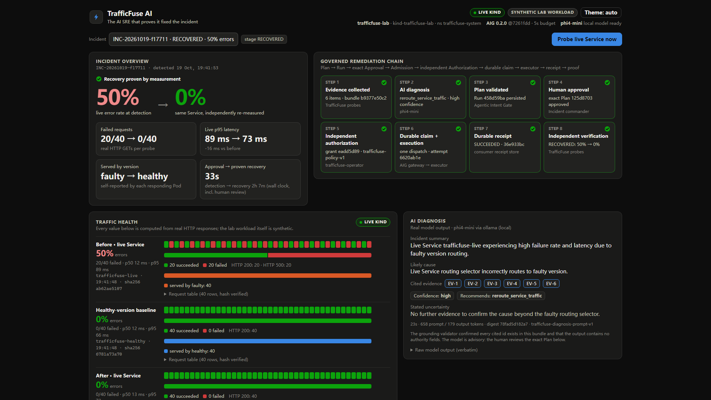
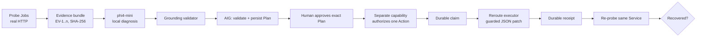

# TrafficFuse AI

**The AI SRE that proves it fixed the incident.** · TechEx Amsterdam Hackathon 2026



When a Kubernetes release starts failing, most "AI agents" either only explain
the incident or act with broad credentials and report success because an API
returned 200. TrafficFuse lets AI act **only through enforceable governance**, and
counts success **only when it is measured**.

1. **Real evidence** — probes the customer-facing Service and the healthy version
   with real HTTP requests in a Kind cluster; every request records which version
   served it; every evidence item is provenance-labelled and SHA-256 audited.
2. **Evidence-grounded AI** — a local model (`phi4-mini` via Ollama) explains the
   incident, cites evidence ids, states its uncertainty and proposes one bounded
   remediation. Invented evidence or self-granted authority is rejected.
3. **Governed remediation** — [Agentic Intent Gate](https://github.com/miku-wwl/agentic-intent-gate)
   validates the Plan; a human approves the *exact* Plan; a *separate* capability
   authorizes one Action; a durable claim allows exactly one dispatch.
4. **One guarded change** — the trusted executor switches the Service selector
   `faulty → healthy` with UID / resourceVersion / selector preconditions checked
   atomically by the Kubernetes API server, then writes a durable receipt.
5. **Proof of recovery** — TrafficFuse re-probes the same Service and declares
   recovery only from the measurements.

## Verified live result (19 Oct 2026, local Kind lab, synthetic workload)

| | Before | After |
| --- | --- | --- |
| Live error rate (40 real requests) | **50.0%** (HTTP 500 × 20) | **0.0%** |
| Served by | `faulty` × 40 | `healthy` × 40 |
| Selector | `version=faulty` (rv 635) | `version=healthy` (rv 25444) |
| Governance | Run `Approved` → Action `Authorized` | Action `Succeeded`, receipt `36e933bc…` |

Approval → proven recovery: **33 s**. Four unsafe proposals (foreign target,
reversed direction, self-granted kubeconfig/scope/budget, smuggled delete step)
were refused by the gate. Full evidence: [docs/AWARD-SPRINT-REPORT.md](docs/AWARD-SPRINT-REPORT.md).

## How it works



| Concern | Owner |
| --- | --- |
| Evidence, probes, Kubernetes inspection, AI diagnosis, grounding, executor, receipts, recovery proof, API, dashboard | **TrafficFuse** (this repository) |
| Plan validation, persistent Runs, exact Plan-Approval binding, admission, independent Authorization, durable claim, Action ledger, idempotency, fail-closed `Unknown` | **Agentic Intent Gate v0.2.0** — pinned, installed, unmodified |

Architecture details: [docs/ARCHITECTURE.md](docs/ARCHITECTURE.md).

## Run it

Requires Python 3.13, [`uv`](https://docs.astral.sh/uv/), and for the dashboard
build Node 18+. Local diagnosis needs [Ollama](https://ollama.com) with `phi4-mini`.

```bash
uv sync
cd dashboard && npm ci && npm run build && cd ..      # builds the dashboard served at /
uv run pytest -q                                      # 554 offline tests
```

| Mode | Start | Purpose |
| --- | --- | --- |
| `simulation` (default) | `uv run uvicorn trafficfuse.api.app:app --port 8000` | Offline: in-process lab services, **no Kubernetes**; real gate, probes, receipts and model. Labelled everywhere. |
| `live` | `TRAFFICFUSE_MODE=live …` | The approved disposable `trafficfuse-lab` Kind cluster only. Setup and demo steps: [docs/LIVE-DEMO-RUNBOOK.md](docs/LIVE-DEMO-RUNBOOK.md). |
| `replay` | `TRAFFICFUSE_MODE=replay …` | Read-only recorded live incident ([demo/replay](demo/replay/recorded-incident.json)); every write returns 403. |

Open <http://127.0.0.1:8000>. The operator CLI (`python -m trafficfuse.cli`)
provisions profiles, authorizes/executes as a separate capability holder, and
exports recorded incidents.

## Safety model

- **Model output proposes; it never selects** credentials, executors, bindings,
  scopes, budgets or grants. Unknown fields in model output are rejected.
- **Approval ≠ Authorization.** Approving dispatches nothing; authorizing
  dispatches nothing; only a durably claimed, authorized Action runs — once.
- **Fail closed.** Ambiguous post-dispatch outcomes are terminal `Unknown`; no
  retry, replay or reconciliation. Stale targets and stale evidence are refused
  before dispatch.
- **A privileged API that stays local.** Mutations only from loopback, only with the
  `X-TrafficFuse-Client` header (cross-site forgery needs a CORS preflight that is never
  granted), Host allowlist against DNS rebinding, and nothing mutating in replay mode.
- **Only the disposable local lab.** Dedicated kubeconfig, exact context and
  namespace, exact kubectl command shapes, ownership re-verified before execution;
  production and foreign clusters are out of scope by construction.
- **Labels never lie.** Live, simulation, replay and test-fixture data are labelled
  on every panel; the lab workload is declared synthetic.

Binding rules: [AGENTS.md](AGENTS.md).

## Documentation

- [docs/PITCH.md](docs/PITCH.md) — submission copy, business value, differentiation, slides, diagram spec
- [docs/DEMO-SCRIPT.md](docs/DEMO-SCRIPT.md) — 3-minute storyboard
- [docs/LIVE-DEMO-RUNBOOK.md](docs/LIVE-DEMO-RUNBOOK.md) — run, demo, reset, troubleshoot
- [docs/AWARD-SPRINT-REPORT.md](docs/AWARD-SPRINT-REPORT.md) — what was built and verified
- [docs/SUBMISSION-READINESS.md](docs/SUBMISSION-READINESS.md) — submission checklist
- [docs/CLAUDE-HANDOVER-REPORT.md](docs/CLAUDE-HANDOVER-REPORT.md) — handover assessment and decisions
- [docs/ARCHITECTURE.md](docs/ARCHITECTURE.md), [docs/PRODUCT-BRIEF.md](docs/PRODUCT-BRIEF.md),
  [docs/COMPETITION.md](docs/COMPETITION.md), [docs/PHASES.md](docs/PHASES.md) (phase history and earlier reports)

## Reuse disclosure and license

TrafficFuse consumes **Agentic Intent Gate v0.2.0**
(<https://github.com/miku-wwl/agentic-intent-gate>, MIT), a pre-existing runtime by the
same author, as a pinned installed dependency (commit
`7261fdd2f47d2b15fabe8faac527eeee37338eb1`). All TrafficFuse-specific code was written
for this hackathon.

TrafficFuse AI is released under the **MIT License** — see [LICENSE](LICENSE). This is
a hackathon prototype, not production software.
