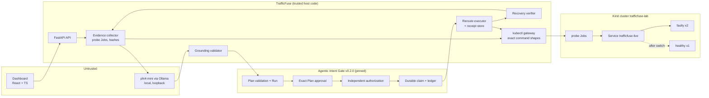

# TrafficFuse AI — Submission Copy, Pitch & Slides

Audience: lablab.ai submission form, judges and the slide deck. Every claim
below is backed by code in this repository and by the live run documented in
[AWARD-SPRINT-REPORT.md](AWARD-SPRINT-REPORT.md). No measured business savings
are claimed.

## Title and tagline

**TrafficFuse AI** — *The AI SRE That Proves It Fixed the Incident.*

## Short description (≈250 characters)

An evidence-grounded AI SRE for Kubernetes releases: a local LLM diagnoses the
incident from real traffic evidence, a governance runtime enforces human approval
and separate authorization, one guarded fix runs, and recovery is re-measured.

## Long description

When a Kubernetes release starts failing, SRE teams face two bad AI options:
assistants that only explain, or autonomous agents that act with broad
credentials and report "done" because an API call returned 200.

TrafficFuse takes a third path: **AI that is allowed to act only through
enforceable governance, and only counts success that it can measure.**

1. **Real evidence.** TrafficFuse probes the customer-facing Service and the
   healthy version with real HTTP requests inside a Kubernetes (Kind) cluster.
   Every request records which version actually served it. Evidence is
   provenance-labelled and SHA-256 audited.
2. **Evidence-grounded AI.** A local model (phi4-mini via Ollama) reads numbered
   evidence items and returns a structured diagnosis: summary, likely cause,
   cited evidence, confidence, uncertainty and one proposed remediation.
   Invented evidence, malformed output and any attempt to supply credentials,
   scopes or budgets are rejected before anything reaches governance.
3. **Governed remediation.** The proposal becomes a Plan validated by the
   Agentic Intent Gate runtime: one allowlisted tool, one target, one step. A
   human approves the *exact* Plan, bound to its fingerprint; a *separate*
   execution capability authorizes exactly one Action. The runtime's durable
   claim allows exactly one dispatch; ambiguous outcomes become terminal
   `Unknown` and are never retried.
4. **One guarded change.** The trusted executor switches the Service selector
   from the faulty to the healthy version, using a JSON patch whose UID,
   resourceVersion and selector preconditions the Kubernetes API server checks
   atomically. A durable receipt binds the effect to the approved payload.
5. **Proof of recovery.** TrafficFuse re-probes the same Service and declares
   recovery only if the measured error rate dropped, every request was served by
   the healthy version, and the routing actually changed.

In our live run on 19 October 2026 the live Service went from **50% errors (40/40
requests served by the faulty version) to 0% (40/40 served by the healthy
version)**, 33 seconds after human approval, with four unsafe proposals refused
by the gate. The workload is a synthetic lab service; all measurements are real
HTTP responses.

## Technology & category tags

Kubernetes · Kind · Ollama · phi4-mini · Local LLM · FastAPI · Python 3.13 ·
React · TypeScript · Vite · SQLite · Agentic Intent Gate · AI governance ·
Human-in-the-loop · SRE · AIOps · Incident response · DevOps

## Business value (stated without invented numbers)

| For | Value |
| --- | --- |
| SRE / platform teams | Faster diagnosis: the model correlates live failures, routing and a healthy baseline into one cited explanation in seconds to tens of seconds (local CPU), instead of manual dashboard hopping. |
| Incident commanders | Lower operational risk: the only executable action is one bounded, preconditioned change on an allowlisted target; unsafe or stale proposals are refused, ambiguous outcomes stop for humans. |
| Engineering leadership / compliance | Clear accountability: who approved which exact Plan, who authorized execution, what was changed (receipt) and whether service health actually recovered (measured evidence) — all durable. |
| Adoption | Works with a local model (no data leaves the environment), reuses an existing governance runtime, and treats "AI recovered the service" as a measurable claim rather than a log line. |

Reduced MTTR is the goal of the design (detection → diagnosis → governed fix →
proof in one place); this prototype does **not** claim measured enterprise MTTR
or ROI improvements.

## Why this is different from a generic AI agent

| Generic autonomous agent | TrafficFuse |
| --- | --- |
| LLM chooses tools, targets and credentials | Model proposes; trusted host code fixes tool, target, scope, credentials and budget |
| "Approve" is a UI button | Approval is bound to the exact Plan fingerprint inside a runtime ledger; execution needs a separate capability |
| Retries until something works | One durable claim, one dispatch; ambiguous = terminal `Unknown`, never retried |
| Success = API returned 200 | Success = re-measured traffic on the same Service |
| Evidence implied | Every cited fact is a numbered, hashed, provenance-labelled evidence item |
| Refusals are prompt-level | Refusals come from the governance runtime's validator and the executor's preconditions |

## Honest limitations

- Synthetic lab workload in a local Kind cluster; not production traffic.
- One trusted tool, single-step execution (a limit of the reused runtime).
- Local capability token is not enterprise SSO; approver identity is an
  unauthenticated local name recorded alongside the runtime's `LOCAL_USER` marker.
- A 3.8B local model can overstate (e.g. it called latency degraded when only
  errors were); the human reviews the cited evidence and the exact Plan.
- No hosted public deployment of privileged operations; a read-only replay mode
  exists for public viewing.

## Reuse disclosure

TrafficFuse consumes **Agentic Intent Gate v0.2.0**
(<https://github.com/miku-wwl/agentic-intent-gate>, MIT), a pre-existing runtime by
the same author, as a pinned installed dependency (commit
`7261fdd2f47d2b15fabe8faac527eeee37338eb1`). It provides Plan validation, persistent
Runs, exact Plan-Approval binding, Action admission, independent Authorization,
durable claims, the Action ledger and fail-closed outcomes. Everything else —
evidence collection, the Kubernetes lab, diagnosis prompt and grounding validator,
the reroute executor and receipt store, recovery verification, API and dashboard —
is TrafficFuse code written for this hackathon.

## Slide deck content (10 slides)

1. **TrafficFuse AI** — The AI SRE that proves it fixed the incident. *(cover image:
   `docs/assets/cover-1920x1080.png`)*
2. **The problem** — Bad releases cause customer-facing 500s in minutes. AI agents
   either only explain, or act with broad credentials and declare success on a 200.
3. **Our answer** — Evidence → AI diagnosis → governed action → measured proof.
   The AI may propose; only governance may act; only measurement may declare victory.
4. **Live demo moment** — screenshot: 50% → 0%, 40/40 faulty → 40/40 healthy, 8-step chain green.
5. **Evidence-grounded AI** — Numbered, hashed evidence; local phi4-mini; grounding
   validator rejects invented ids and authority fields; uncertainty shown.
6. **Governance that is enforced, not displayed** — Agentic Intent Gate: exact
   Plan approval, separate capability authorization, durable one-shot claim, fail-closed Unknown.
7. **One guarded change** — JSON patch with UID / resourceVersion / selector
   preconditions; durable receipt; evidence freshness window; ownership re-verified.
8. **Proof of recovery** — Re-probe of the same Service; 4 checks; API success is never proof.
9. **Unsafe proposals refused** — wrong target, reversed direction, self-granted
   kubeconfig/scope/budget, smuggled delete step: all `PlanRejected` by the gate.
10. **Business value & what's next** — Faster cited diagnosis, lower change risk,
    auditable accountability. Next: more bounded tools (rollback, scale), SSO-backed
    approvals, Prometheus evidence, multi-cluster read-only diagnosis.

## Architecture diagram specification

Nodes (left → right), trust boundaries as dashed groups:

- **Untrusted inputs:** Browser dashboard (React/TS), model output.
- **TrafficFuse (trusted host code):** FastAPI API · Incident service · Evidence
  collector · Grounding validator · Recovery verifier · Reroute executor + receipt
  store · kubectl gateway (exact command shapes).
- **Agentic Intent Gate v0.2.0 (pinned, unmodified):** Plan validator · Run ledger
  · Approval binding · Admission · Authorization policy · Durable claim / Action
  ledger.
- **Local model:** Ollama phi4-mini (loopback).
- **Kind cluster `trafficfuse-lab`:** Service `trafficfuse-live` → Deployments
  `faulty` (2) / `healthy` (1); probe Jobs.

Edges: probes → evidence bundle → model → grounding validator → Plan → gate (validate,
persist) → human approval → capability authorization → durable claim → executor →
kubectl patch → receipt → verifier → probe Job → verdict.

